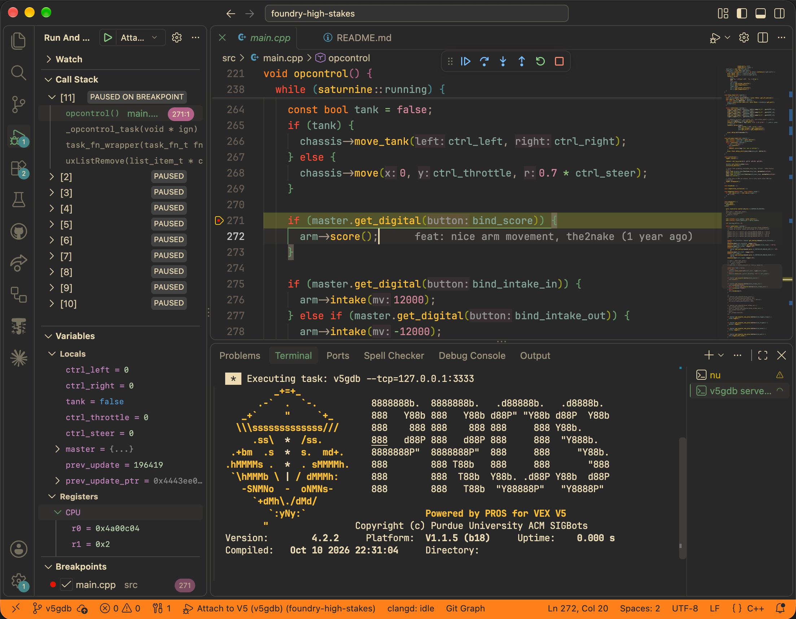

# v5gdb: VEX V5 debugger

> *"One day we will have all the features of ROBOTC on the V5 brain" - Charles, 2114V*

v5gdb is a debug toolkit for VEX V5 that lets you pause your program in any function, set breakpoints and step through code, view any variable or argument, and more. You can use it to connect [GDB](https://en.wikipedia.org/wiki/GNU_Debugger) (or any other debugger that supports its protocol) to your VEX V5 robot.

v5gdb runs directly on your VEX V5 so you can debug a program in the environment where it will actually run.




## Getting Started

Please read the [user manual] for detailed installation and usage instructions!

[user manual]: https://github.com/vexide/v5gdb/wiki

### Rust (vexide)

```rust
use v5gdb::prelude::*;

#[vexide::main]
async fn main(_peripherals: Peripherals) {
    v5gdb::install(V5Debugger::stdio().stop_motors_on_break(true));
}
```

### C++ (PROS)

```cpp
#include "v5gdb/v5gdb.h"

void initialize() {
    v5gdb::install({.stop_motors_on_break = true});
}
```

Connect from your computer with `v5gdb path/to/program.elf` (the ELF path is optional in PROS projects).

<!-- ### Installing the CLI

The `v5gdb` command connects GDB (or another debugger you have installed) to a V5 brain over USB.

#### Install via [Cargo Binstall](https://github.com/cargo-bins/cargo-binstall#readme)

> *Supports all platforms; requires Cargo Binstall is installed*

```sh
cargo binstall v5gdb-cli
```

#### Install via [Homebrew](https://brew.sh)

> *Supports macOS & Linux; requires Homebrew is installed*

```sh
brew install vexide/vexide/v5gdb
```

#### Install via shell script

> *Supports macOS & Linux*

```sh
curl --proto '=https' --tlsv1.2 -LsSf https://github.com/vexide/v5gdb/releases/latest/download/v5gdb-cli-installer.sh | sh
```

#### Install via PowerShell script

> *Supports Windows*

```powershell
irm https://github.com/vexide/v5gdb/releases/latest/download/v5gdb-cli-installer.ps1 | iex
```

#### Compile from source via Cargo

> *Supports all platforms; requires Cargo is installed*

```sh
cargo install v5gdb-cli
``` -->

## Features

### Debugging

- Set breakpoints and step through your code line by line.
- Pause the program anywhere by pressing Ctrl-C, including in infinite loops without sleeps.
- Read and change variables, function arguments, globals, registers, and memory.
- In PROS, each FreeRTOS task shows up as its own thread. While you step through one task, the
  others stay paused.

### Robot commands

v5gdb extends GDB's `monitor` command with V5-specific tools:

- `monitor stop` stops all motors. `monitor autostop true` (or `stop_motors_on_break` in your
  code) stops all motors every time the program pauses.
- `monitor comp` changes the competition mode your program sees (driver, autonomous, disabled),
  so you can test competition code without a field controller.
- `monitor devices`, `monitor battery`, and `monitor ctrl` show the status of various connected
  devices.

### Setup

- No extra hardware: v5gdb uses the same USB connection you upload programs with, and your program's
  terminal output still shows up while you debug.
- No configuration required: add one line to your program and run `v5gdb`.
- Available via Cargo (vexide) or PROS Conductor (PROS).

### Compatibility

v5gdb uses the same protocol as gdbserver (GDB Remote Serial Protocol), so your favorite debugger probably already supports it. Supported debuggers include: GDB, LLDB, the C/C++ extension in VS Code, CLion, Eclipse CDT, rust-gdb, and more.

By default, running the `v5gdb` command will start GDB as a subprocess, but if you'd like to connect to a different debugger (such as one listed above) you can start it in [TCP Server Mode](https://github.com/vexide/v5gdb/wiki/Command%E2%80%90line-interface#--tcp-tcp-server-mode).

## Design

This project implements a debug server that can communicate with a GDB-compatible client over various transport methods. For more information, see the project's [internals wiki page](https://internals.vexide.dev/technical/debugger).

## License

Licensed under either of

* Apache License, Version 2.0

  ([LICENSE-APACHE](LICENSE-APACHE) or <http://www.apache.org/licenses/LICENSE-2.0>)
* MIT license

  ([LICENSE-MIT](LICENSE-MIT) or <http://opensource.org/licenses/MIT>)

at your option.

## Contribution

For guidelines for contributors, see [CONTRIBUTING.md](CONTRIBUTING.md).

Unless you explicitly state otherwise, any contribution intentionally submitted for inclusion in the work by you, as defined in the Apache-2.0 license, shall be dual licensed as above, without any additional terms or conditions.
